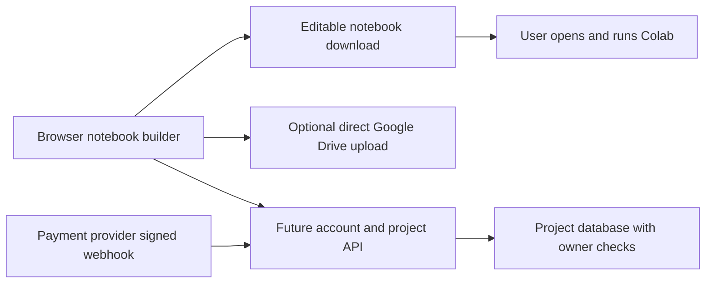

# Nooble SaaS readiness

Assessment reviewed November 7, 2026; publication status updated November 8, 2026. **Current status: public builder preview; not ready to accept subscriptions.** This is an engineering and product assessment, not legal clearance. The browser and editable notebooks work as a configuration tool; a production SaaS remains to be built and validated.

## What we should sell

Nooble helps creators prepare, reuse and maintain MiniMax H3 workflows for their own Colab account. Keep the notebook as the core output and the Free builder as a useful entry point. Pro should earn its price through maintained, tested workflows and repeat-use convenience.

More sliders alone are a weak subscription offer: exported notebooks are editable and the code is MIT licensed. That is expected open-source behavior, not a defect to hide. Test whether users repeatedly need curated workflow updates, cloud project history and reusable profiles before building a subscription around them. These proposed services do not exist yet. If repeat demand is absent, a paid workflow pack or support offering may fit better than recurring billing.

Free means no Nooble charge. It does **not** mean free A100 access, free Drive storage or included GPU time. Nooble Pro and Google's Colab plans would be separate purchases. Do not advertise instant generation, guaranteed GPU availability, unlimited video, or LoRA training.

## What is wrong with treating the preview as a SaaS today

| Gap | Evidence and consequence | Next action |
| --- | --- | --- |
| Generation promise exceeds evidence | Only the original FL2VA Turbo 8 path at 864×480 has a recorded successful GPU run. The refactored runtime and 1344×768 default are not GPU-validated. | Verify the actual exported notebook before marketing its defaults as reliable. Keep other paths experimental until measured. |
| Onboarding is for developers | The builder is publicly accessible, but Drive upload still asks each customer to create a Google Cloud OAuth application. | Keep download available now; for public upload, configure one operator-owned production OAuth app and a domain the operator controls. |
| Pro is only a demonstration | Plan state lives in browser JavaScript. No accounts, subscriptions or server authorization exist. | Keep the explicit no-charge preview. Add a server entitlement check only when introducing paid server features. |
| Recurring value is unproven | Current value is mainly editing settings before downloading an open notebook. | Observe repeat use and willingness to pay before choosing a subscription price. |
| Portability and privacy need clarity | Projects live only in browser storage. Notebooks and workflow JSON include prompts. Drive uploads and outputs outlive a local project. | Explain storage/cleanup; retain notebook export. Add account export/deletion and ownership enforcement with any future cloud storage. |
| Releases are only partially reproducible | Model/ComfyUI revisions are pinned, but Python dependencies can float. The notebook loads `v0.2.0`, not the current runner on `main`. | Capture a successful GPU environment, test dependency constraints, publish an immutable runtime release and update consumers together. |
| Operations are missing | There is no public service support policy, production monitoring, payment recovery or account lifecycle. | Establish support ownership, minimal redacted error monitoring, rollback and incident procedures before taking payments. |
| Hosted CI is absent | Checks currently run locally; no CI workflow is configured. | Connect `python scripts/check.py` to CI with an appropriately authorized repository credential before relying on automated release gates. |

## Platform and model launch constraints

[Colab's additional terms](https://research.google.com/colaboratory/tos_v6.html) prohibit account sharing and providing third parties direct or indirect access to Colab. Sell the notebook-building service, not access to an operator's Colab runtime. [Colab's FAQ](https://research.google.com/colaboratory/faq.html) also limits free-runtime web-UI bypasses and does not guarantee resources. Keep execution interactive in each user's notebook; do not promise that a payment to Nooble buys Google compute. The exact commercial flow still needs review.

The [MiniMax H3 license](https://huggingface.co/MiniMaxAI/MiniMax-H3/blob/main/LICENSE) excludes the EU, UK, Republic of Korea and US from its default territory, requires commercial attribution, and has an additional authorization threshold above US$20 million yearly revenue. Resolve applicability to the intended customers, distribution and hosting before public paid launch. Repository MIT licensing is separate; do not assume a notebook-only product automatically avoids model conditions.

For public Google integration, use separate test/production projects, secure origins, an owned verified domain, a public home page and an accurate privacy policy. Scope/brand verification depends on the app's configuration. `drive.file` is Google's recommended non-sensitive per-file scope; it does not mean all production requirements disappear. Making the preview public does not itself satisfy production OAuth requirements. Sources: [Google production OAuth policy](https://developers.google.com/identity/protocols/oauth2/production-readiness/policy-compliance), [Drive scopes](https://developers.google.com/workspace/drive/api/guides/api-specific-auth).

## Smallest professional architecture

Keep the existing browser and exporter. Add one small service when cloud accounts or payments are introduced; avoid rewriting the frontend or hosting model inference at this stage.

The future API authenticates sessions, authorizes project ownership and checks active entitlements on every paid operation. It stores payment customer/subscription identifiers and entitlement state, not card details. Verify webhook signatures, deduplicate events, reconcile provider state and cover refunds, cancellations, failed renewals and expiry. A checkout success URL or client flag is not proof of payment. [Stripe's webhook documentation](https://docs.stripe.com/webhooks) is one implementation reference, not a selected or connected provider.

Keep Drive tokens out of the project database unless a separately justified background feature requires server custody. Direct browser uploads can retain the existing memory-only token design. Do not collect prompts/media in analytics by default. Add backups and account export/deletion before promising cloud project storage.

## Validation and release gates

Run `python scripts/check.py` before publishing code. It performs core offline tests, builds the browser and syntax-checks eight exported notebooks. This is a **code check**, not a GPU, OAuth, legal or commercial approval.

| Path | Current evidence | Required before calling it supported |
| --- | --- | --- |
| Browser notebook export | Automated checks and manual browser download | Preserve clean cells and correct parameters on each release. |
| Original Turbo 8 at 864×480 | One successful original Colab clip | Reproduce through the current exported notebook. |
| Current Turbo 8 at 1344×768 | Offline graph/export checks | Fresh and cached A100 runs; record setup/generation time, peak VRAM/RAM and MP4 audio/video playback. |
| FL2VA Base 20 / Turbo 4 | Offline checks | Separate actual GPU results with pinned runtime and settings. |
| First-frame and Ref2VA workflows | Offline checks | Actual image/reference runs; test image reselection and reproducibility. Keep Ref2VA Turbo 4 experimental. |
| Custom LoRA | Parsing/loading graph checks | A licensed compatible adapter per supported family, documented trigger/strength and actual output. No training claim. |
| Browser Drive upload | Mocked request tests | Live consent, cancellation, expiry/reconnect, small/large image, partial-failure recovery and opening the uploaded notebook. |
| Subscriptions/cloud accounts | Not implemented | Owner isolation, server entitlement, webhook replay/order cases, cancellation/refund and account export/deletion. |

Record evidence with release/commit, GPU and memory, package versions, preset, dimensions, requested/actual duration, cold/warm timings, result and redacted errors. Keep any private prompts or media outside public issues. Follow [CONTRIBUTING.md](../CONTRIBUTING.md) when releasing a new runtime; changing `main` alone does not update `v0.2.0` notebooks.

## Order of work

1. **Validate the notebook first.** Complete the current-default GPU and live Drive gates. Capture the working environment and failure recovery. The current public builder preview has no checkout; do not enable payments before these gates pass.
2. **Run a small pilot.** Proposed starting cohort: five independent users who have suitable Colab access and permission to use the model. Observe template selection → download/upload → first playable video. Record where they need help and whether they return for a second project. This is a proposed study, not existing traction.
3. **Prepare public onboarding.** Decide the operator/customer territory, domain, support contact, privacy/service terms, production OAuth configuration and honest compute requirements. These require owner decisions; no domain purchase or public access change is assumed.
4. **Build one paid benefit.** Choose the recurring need demonstrated by the pilot, then add managed authentication, a minimal project/entitlement API and payment integration. Test the complete lifecycle in sandbox before enabling live charges.
5. **Expand after retention.** Add other model families only after the MiniMax workflow works reliably and each model's rights and operating cost are reviewed.

Measure first-video completion, time to first playable result, second-project usage, support effort per active user and conversion after repeat use. Track hosting, storage/egress, payment fees, support and GPU validation costs. Customer-owned Colab compute does not make the business cost-free. Set pricing from observed value and service cost; no price or revenue forecast is established here.
